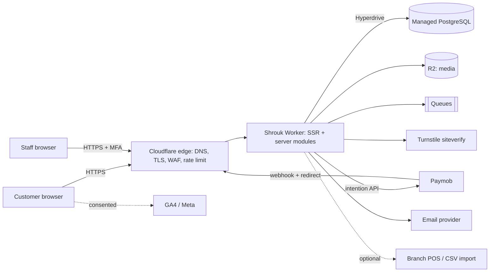
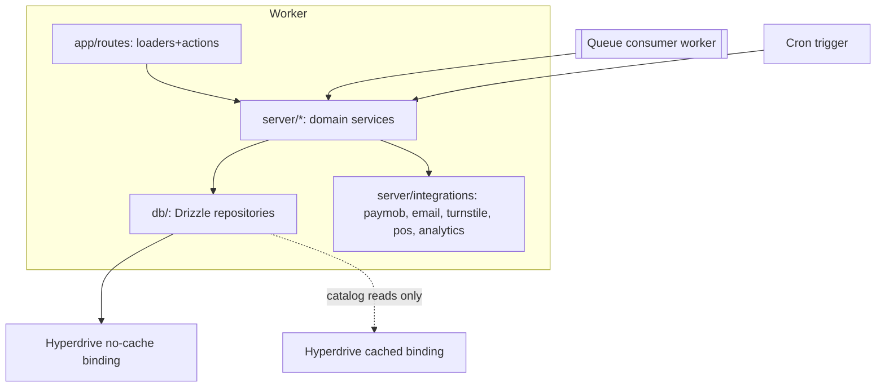
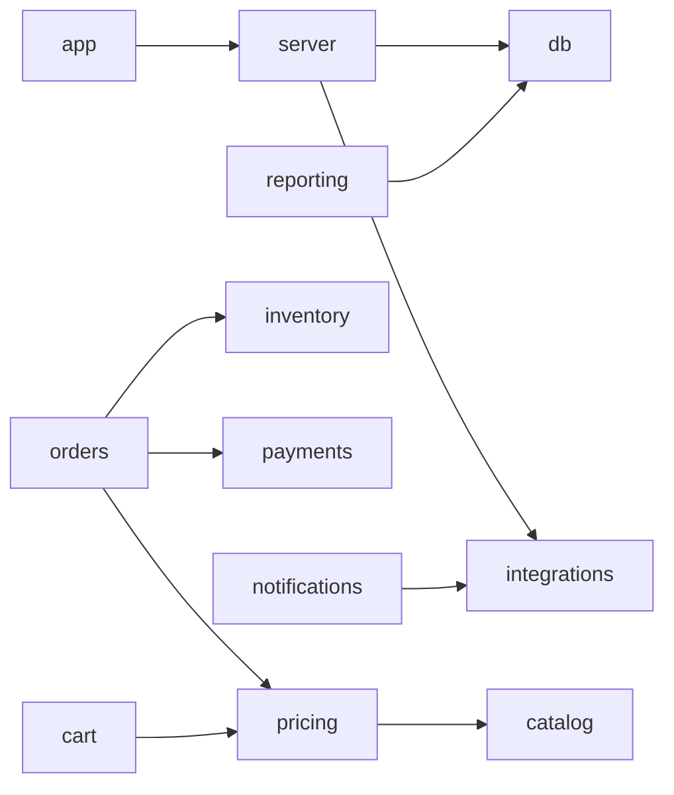
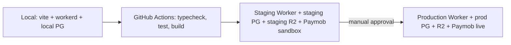

# Architecture

Style: modular monolith on a single Cloudflare Worker (SSR). No microservices. Layering: `app` → `server` → `db`; external providers only through adapters in `server/integrations`.

## Stack and verified versions (npm registry, checked during Phase 0)

| Piece | Version | Note |
|---|---|---|
| react-router | 8.5.1 | Framework mode, SSR. Master prompt says v8; confirmed it exists. |
| @cloudflare/vite-plugin | 1.66.0 | Official Workers dev/build integration |
| wrangler | 4.155.0 | |
| vite | 8.3.5 | |
| tailwindcss | 4.3.3 | Tokens via CSS `@theme` |
| drizzle-orm | 0.45.4 | + drizzle-kit for migrations |
| zod | 4.6.7 | |
| motion | 14.7.1 | |
| vitest / playwright | 5.0.5 / 1.64.1 | Phase 1 must confirm peer compatibility and `workerd` behaviour before locking versions |
| Node (dev machine) | 24.12.0 | |

Compatibility of each library with `workerd` (no `fs`, no native modules) is verified by running in the Workers runtime in Phase 1, not assumed. Postgres driver choice (`postgres` vs `pg`) via Hyperdrive is decided by a spike in Phase 1/3.

## C4 — context

## C4 — containers

Two Hyperdrive bindings: `DB` (caching disabled; sessions, permissions, cart, checkout, inventory, payments, admin) and `DB_CACHED` (explicit stale-tolerant catalog/CMS reads only). Repository functions declare which binding they use; stock and price validation at checkout always use `DB`.

## Request lifecycle

1. Edge: TLS, WAF/rate-limit rules, security headers added in Worker.
2. Worker entry assigns a correlation ID (`cf-ray` fallback to UUID), parses locale from path.
3. Route loader/action: Zod-parse input → authenticate (session cookie, server-stored) → authorize (`can(user, action, resource)`) → domain service → repository → response.
4. Errors are mapped to typed results; sanitised structured log line with correlation ID.
5. SSR render with locale + theme (theme cookie read server-side to avoid flash; `system` resolved by a tiny inline script before paint).

## Domain modules (`server/`)

auth, catalog, pricing, cart, inventory, orders, payments, fulfillment, branches, customers, cms, marketing, reporting, notifications, integrations, security. Dependency rule: orders → (pricing, inventory, payments adapter); pricing → catalog; reporting reads only; nothing imports from `app`. Domain rules (pricing, stock, state machines) exist once in `server/` and are used by both storefront and admin routes.

## Dependency map

## Deployment

Separate Postgres databases, R2 buckets, Queues, Hyperdrive configs and secrets per environment. Secrets via `wrangler secret`. Migrations run from CI with a dedicated migration credential; runtime credential has no DDL rights. Production deploy and live payment activation are separate, approval-gated steps.

## SEO / URL policy

Canonical = unfiltered listing. Pagination `?page=n` is self-canonical and indexable up to a limit; sort/filter params `noindex,follow` and canonical to base. `hreflang` ar-EG / en-EG + `x-default` → `/ar`. Sitemap per locale with alternates.

## Observability

Structured JSON logs with correlation ID, Workers Logs/Logpush, error monitoring (provider TBD: Sentry vs Cloudflare-native), alerts on webhook failures, payment mismatches, queue DLQ depth. Logs never contain card data, secrets, prescriptions, or full PII.

## ADR summary

Full list in `decisions.md`.
