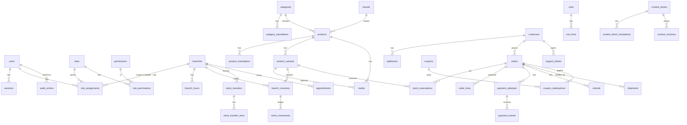
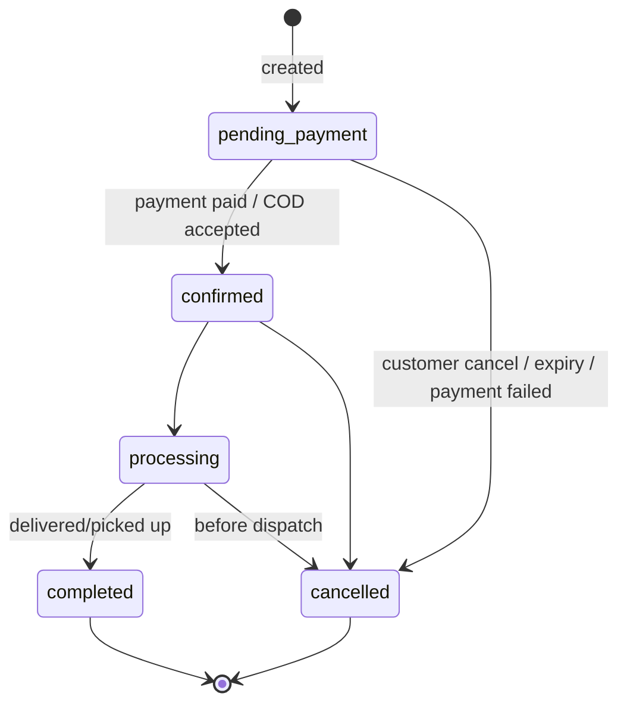
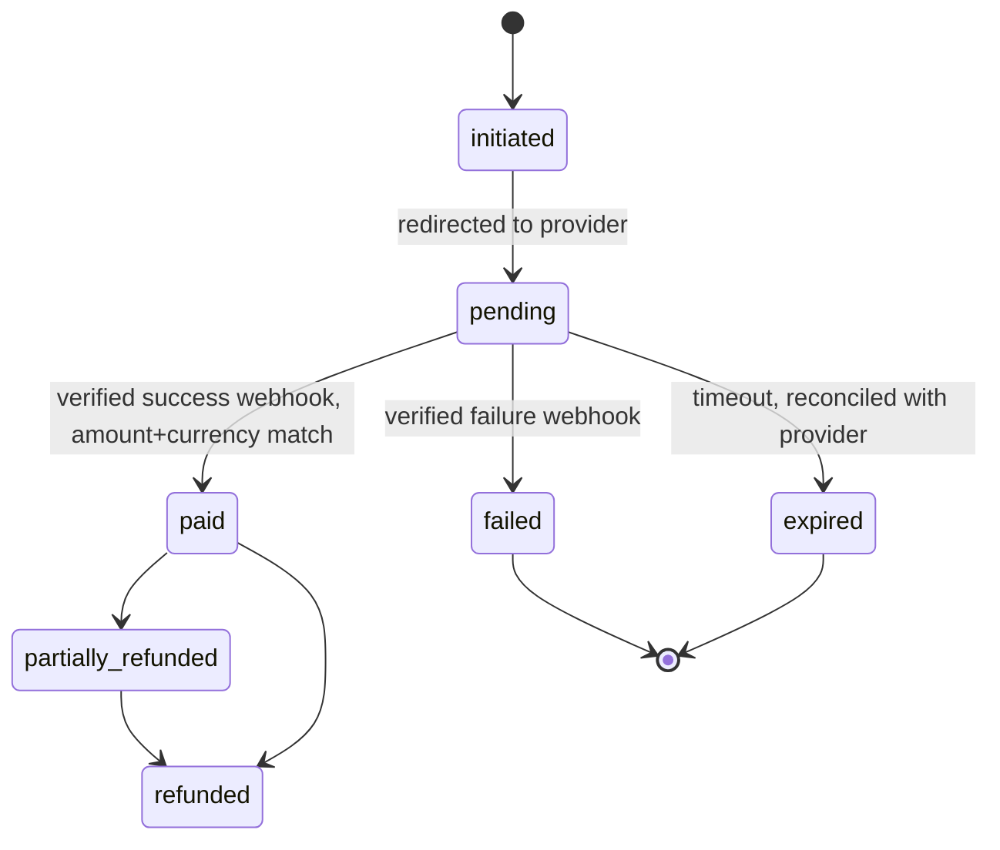
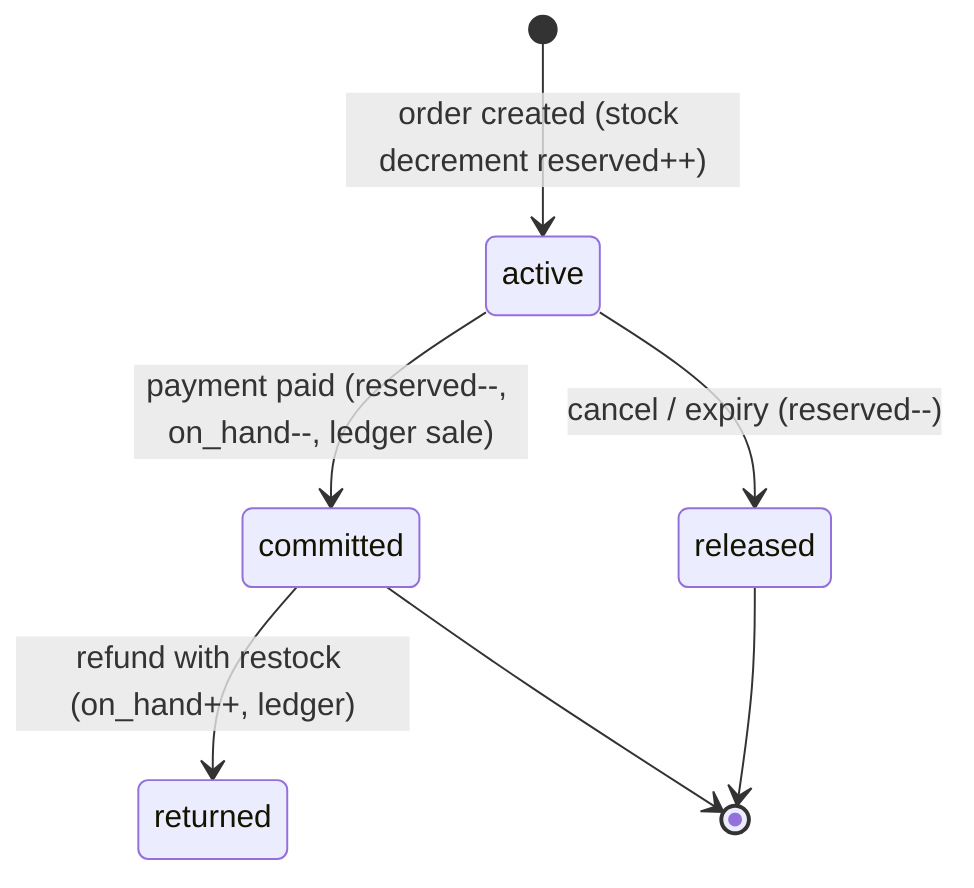

# Data model (ERD) and state machines

Conventions: random UUID primary keys (v4 in this build, see decision 022); `created_at`/`updated_at` timestamptz; money = `integer` piasters (1 EGP = 100) with `CHECK (>= 0)`; currency fixed `EGP` in MVP; enums as Postgres enums or `CHECK` text; translations in `*_translations (entity_id, locale)` tables, not JSON blobs; soft-delete (`archived_at`) for catalog entities; order lines are immutable snapshots.

## Tables (grouped)

- **Identity**: `users` (staff), `sessions` (token hash, user agent, expires, revoked_at), `mfa_credentials`, `invites`, `roles`, `permissions`, `role_permissions`, `role_assignments (user, role, branch_id NULL)`; `customers` (optional account; guest orders keep contact snapshot), `customer_sessions`, `consents` (type, granted, source, timestamp — history, append-only).
- **Branches**: `branches` (slug, verified flag, `offers_exams`, `pickup_enabled`, phone, geo), `branch_translations`, `branch_hours`.
- **Catalog**: `categories`(+translations), `brands`, `products`(+translations: name, description, slug, SEO), `product_variants` (sku unique, price_piasters, compare_at, attributes: colour, size; status), `product_attributes` / values (frame shape, material, UV rating as typed columns/lookup tables), `media` (r2_key, alt translations, sort, kind), `lens_options`, `lens_compatibilities` (Phase 2, only when pricing rules confirmed), `price_lists`.
- **Inventory**: `branch_inventory (branch_id, variant_id, on_hand, reserved)` with `CHECK (on_hand >= 0 AND reserved >= 0 AND reserved <= on_hand)`; `stock_movements` (append-only ledger: type receipt/sale/adjustment/transfer_out/transfer_in/return/reservation_release, qty signed, reason, actor, ref); `stock_reservations` (order, variant, branch, qty, status, expires_at); `stock_transfers` + lines (status below).
- **Cart/Orders**: `carts` (opaque id cookie, customer nullable, expires), `cart_lines`; `orders` (ref human code, status, payment_status, fulfillment_status, totals in piasters, currency, shipping/pickup method, contact + address snapshot, idempotency_key unique, locale, utm); `order_lines` (variant_id, sku, title ar/en, unit price, discount, tax, qty — snapshot); `order_events` (status history).
- **Payments**: `payment_attempts` (provider, provider_order_id, intention id, amount, currency, status, idempotency key), `payment_events` (provider event id **unique**, raw payload sanitised, hmac_valid, processed_at, outcome), `refunds` (order, amount ≤ captured, status, provider ref, reason, actor), `ledger_entries` (financial: charge, refund, cod_collected; separate from analytics).
- **Fulfilment**: `shipments` (carrier, tracking ref, status), pickup status on order.
- **Marketing**: `coupons` (code, type, value, min, limits, window, stackable flag), `coupon_redemptions` (unique per order), `promotions`, `campaigns`.
- **CMS**: `content_blocks` (key, type, status draft/published, schedule), `content_block_translations`, `content_revisions` (snapshot for rollback), `pages`, `blog_posts`(+translations), `blog_categories`, `nav_items`.
- **Support/CRM**: `support_tickets`, `ticket_messages`, `customer_notes` (restricted permission). Prescription data: **not collected in MVP**; if later approved it goes in a separate table with field-level encryption and its own permission.
- **Appointments**: `appointment_slots`, `appointments` (branch, status, contact) — only for exam-enabled branches.
- **Audit/config**: `audit_entries` (actor, action, entity, before/after hashes or diff, ip, correlation id; append-only), `integration_configs` (names/status/non-secret metadata only; secrets live in Worker secrets), `idempotency_keys`, `job_runs`.

## Integrity rules

- FKs everywhere; `ON DELETE RESTRICT` for orders/payments.
- Unique: `variants.sku`, `orders.ref`, `orders.idempotency_key`, `payment_events.provider_event_id`, `(coupon_id, order_id)`, `(branch_id, variant_id)`.
- Stock changes happen in one transaction: `SELECT … FOR UPDATE` on the inventory row (or atomic `UPDATE … WHERE on_hand - reserved >= qty RETURNING`), insert ledger row, update counters. No oversell; no boolean "allow negative".
- Order price math is a pure function in `server/pricing`, rounding half-up on piasters, applied once at order creation; stored totals are authoritative afterwards.
- Tax: columns exist (`tax_piasters`), calculation disabled until the business confirms treatment.

## State machines

### Order (status) — payment and fulfilment are separate fields

### Payment

COD: `awaiting_collection → collected` (courier/branch settlement event, actor recorded) → `reconciled`. Never `paid` on submit.

### Fulfilment

`unfulfilled → packing → ready_for_pickup | shipped → delivered | pickup_collected`; exceptions: `delivery_failed → returned`.

### Inventory reservation

Expiry worker releases `active` reservations past `expires_at` (default 30 min for online payment — configurable) idempotently; a late successful webhook on an expired reservation tries to re-reserve, otherwise flags the order for manual refund/exception queue.

### Transfer

`requested → approved → dispatched → received` (or `rejected` / `cancelled`); dispatch decrements source, receive increments destination, discrepancies create an `adjustment` with reason.
