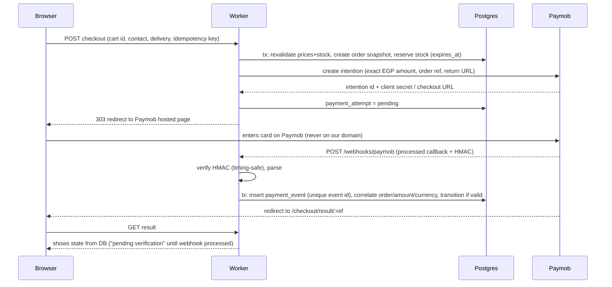

# Payment flow (Paymob hosted checkout)

Status (end of Phase 5): implemented and tested against a **local stub and synthetic signed callbacks only**. No Paymob merchant account or sandbox credentials exist yet, so nothing here has been run against Paymob's real sandbox or live system, and no real money has moved.

## What was checked against Paymob's documentation

- Intention API: `POST https://accept.paymob.com/v1/intention/`, header `Authorization: Token <secret key>`, body with `amount` (piasters), `currency`, `payment_methods` (integration id), `items` (amounts must sum to `amount`), `billing_data` (phone required), `special_reference`, `notification_url`, `redirection_url`; response `client_secret` and `intention_order_id`; hosted page `https://accept.paymob.com/unifiedcheckout/?publicKey=…&clientSecret=…`.
- Processed callback HMAC: SHA-512 with the integration's HMAC secret, sent as the `hmac` query parameter, over these 20 values concatenated in order with no separator: `amount_cents, created_at, currency, error_occured, has_parent_transaction, obj.id, integration_id, is_3d_secure, is_auth, is_capture, is_refunded, is_standalone_payment, is_voided, order.id, owner, pending, source_data.pan, source_data.sub_type, source_data.type, success`; booleans as `true`/`false`. A unit test reproduces the exact concatenated string from Paymob's published example.

## Still unverified (must be confirmed in the sandbox before go-live)

1. How Paymob serialises a `null` `source_data.pan` / `sub_type` / `type` (wallets, kiosks) inside the HMAC string. The code uses an empty string.
2. Transaction inquiry (`/api/ecommerce/orders/transaction_inquiry`) and refund (`/api/acceptance/void_refund/refund`) endpoints and their auth flow come from third-party material, not from Paymob's reference. They only run when `PAYMOB_API_KEY` is set; reconciliation and refund execution must not be relied on until verified.
3. Whether refund/void callbacks report the cumulative refunded amount in `refunded_amount_cents` (the code assumes so and records only the difference).
4. Intention expiry and client-secret lifetime (sources disagree); our stock hold is 30 minutes, so a longer provider window is harmless but a shorter one would show the customer a dead checkout.
5. Which payment methods the merchant account enables (only cards are offered; Meeza, wallets, instalments are not rendered).

## Implementation map

- `server/payments/provider.ts`: provider-neutral interface (`createCheckout`, optional `inquire`, `refund`).
- `server/payments/paymob.ts`: adapter, HMAC build/verify, callback normalisation (no card or billing data kept).
- `server/payments/service.ts`: `startOnlinePayment`, `handleProviderEvent` (idempotent, order-independent), refunds with four-eyes approval, `reconcilePendingPayments`.
- `app/routes/webhook-paymob.tsx`: `POST /webhooks/paymob` (401 on a bad signature, 413 over 64 KB, 405 for GET).
- Tables: `payment_attempts`, `payment_events` (unique event key), `refunds`, `ledger_entries` (unique per order/type/reference).
- Config: `PAYMOB_SECRET_KEY`, `PAYMOB_PUBLIC_KEY`, `PAYMOB_HMAC_SECRET`, `PAYMOB_INTEGRATION_ID` (all four enable card payment), optional `PAYMOB_API_KEY`; `PAYMOB_BASE_URL` is accepted only when `APP_ENV=development`.

## Rules

1. Order and reservation are created before calling the provider; provider failure leaves the order `pending_payment` and the reservation to expire (or immediate release on definite error).
2. `Idempotency-Key` per checkout submit prevents duplicate orders on double click/refresh.
3. Only a webhook that passes HMAC **and** matches stored amount (piasters), currency and order, and whose transition is legal, can mark a payment `paid`. Success → reservation `committed`, order `confirmed`, notification job enqueued.
4. Duplicate event (same provider event id) → 200, no effect. Out-of-order (failure after success, success after cancel) → recorded; illegal transitions never downgrade `paid`; paid-after-cancel/expiry raises an exception for manual refund or re-reserve.
5. Amount mismatch or unknown order → logged, alert, 200/4xx per provider retry semantics, no state change.
6. Scheduled reconciliation (Cron + Queue) queries the provider API for `pending` attempts older than N minutes and applies the same transition function as the webhook.
7. Refunds: admin request → finance approval → provider refund API → verified refund event updates `refunds`, order payment status, ledger, and optionally restocks.
8. COD: order `confirmed` with payment `awaiting_collection`; becomes `collected` only by an authenticated staff/courier settlement action; reconciliation report per branch/courier.
9. Enabled methods are config-driven per environment from verified provider capability; unverified methods (installments, Meeza, wallets, InstaPay) are not rendered.
10. Analytics `purchase` event is emitted once from the confirmed order state (server-side dedupe by order ref), independent of the financial ledger.

## Tests required to pass the Phase 5 gate

Valid HMAC success; invalid HMAC rejected; replay of same event; failure then success; success then failure; amount mismatch; expired reservation + late success; double-submit checkout; reconciliation picks up missed webhook; refund partial/full; no card data in DB/logs (grep test on fixtures).
